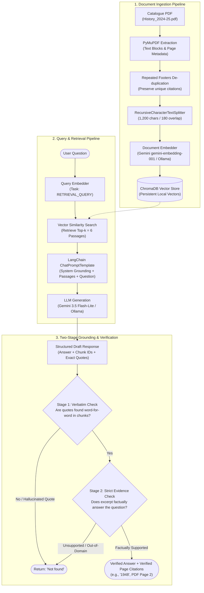
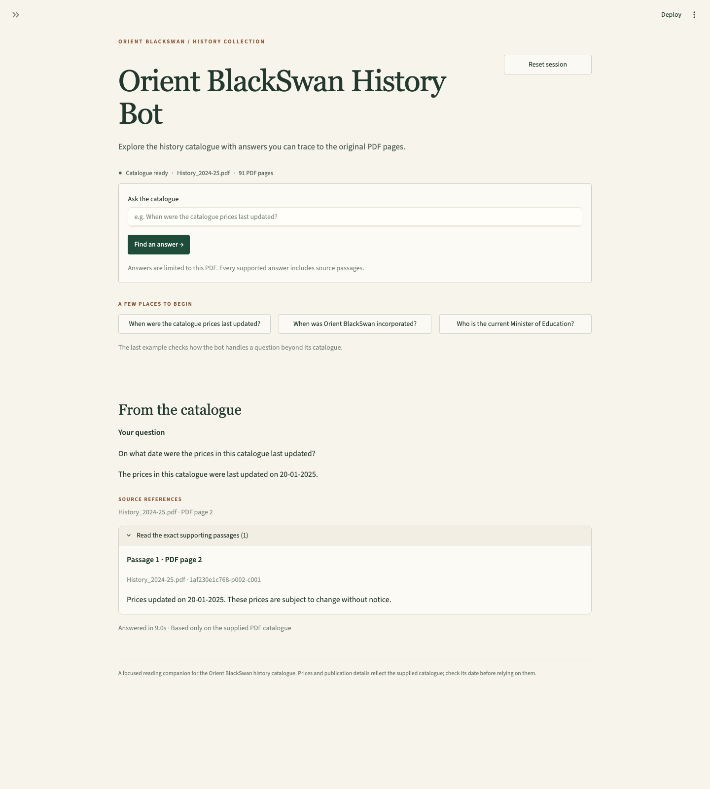
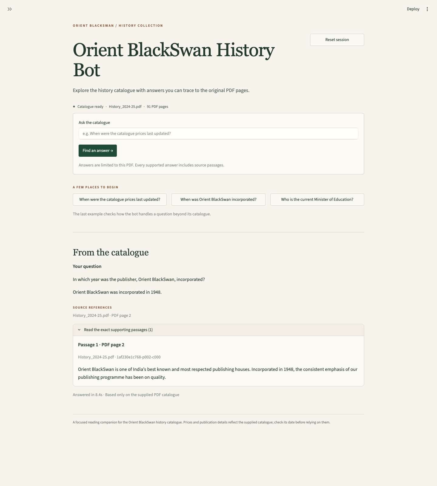
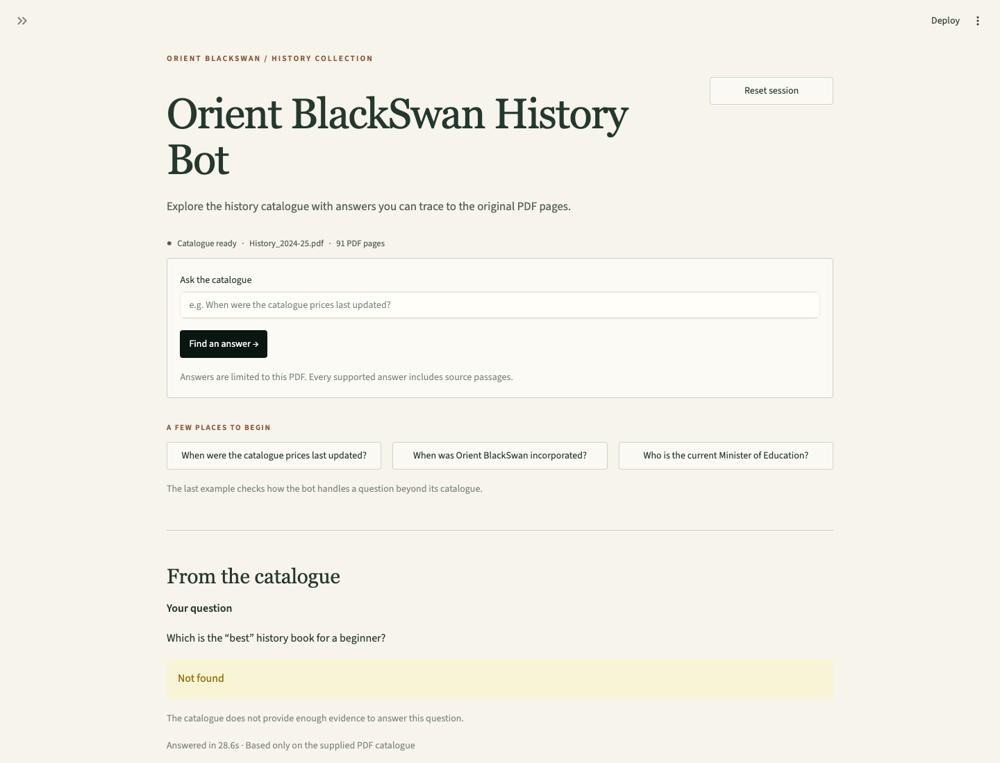
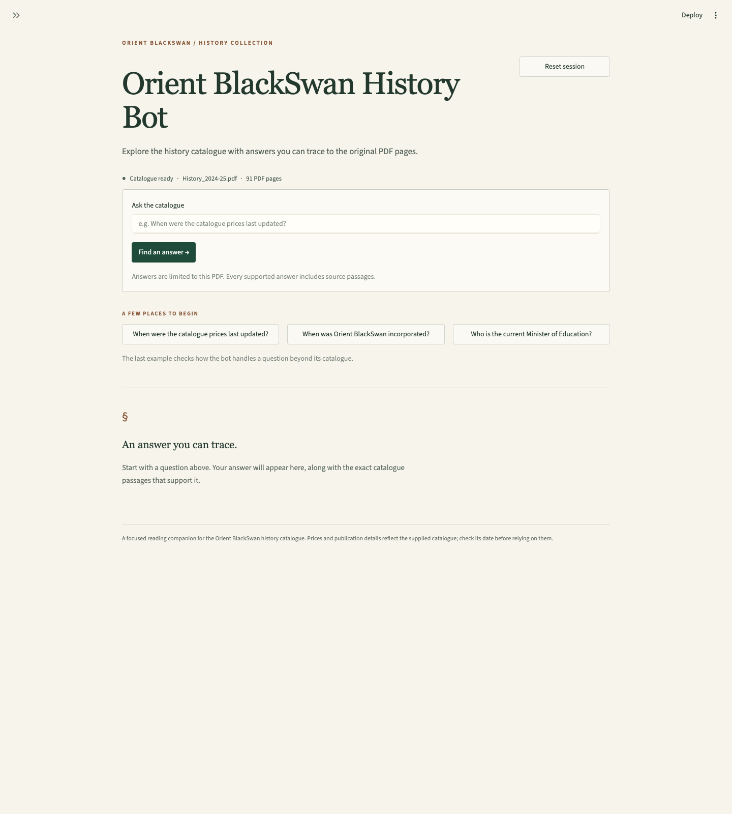
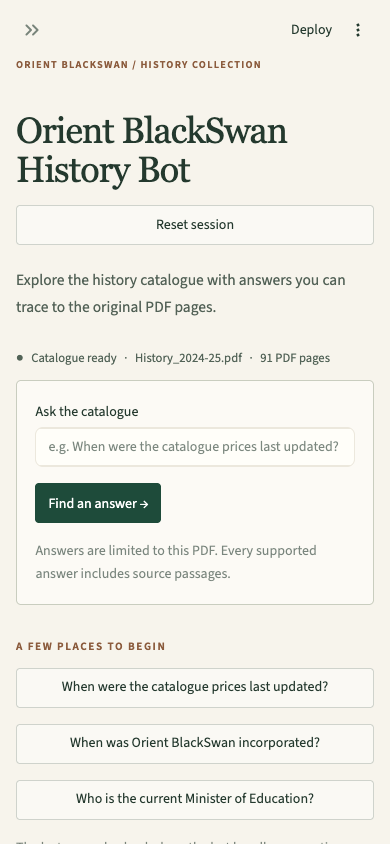

# Orient BlackSwan History Bot

Project 4 of the GenAI midterm: a Python, LangChain, and ChromaDB application that answers questions using only the **Orient BlackSwan History catalogue 2024–25**. Supported answers include an exact excerpt and a PDF page reference. Unsupported answers are exactly `Not found`.

The application supports **Gemini for generation and embeddings**, with a Streamlit interface. This mode needs a Gemini API key and an internet connection; Ollama is optional. Each question runs through retrieval and validation; suggested questions do not have prewritten answers.

**Gemini verification status:** a key is configured privately, and live embedding and structured-chat smoke checks passed. Full catalogue ingestion and answer-quality evaluation are still pending. The existing 14/14 evaluation and assessment screenshots below are evidence from the earlier **Ollama** configuration.

**Submission status:** the project is prepared locally. This checkout has no configured Git remote or published repository URL yet. Publish it to your submission repository and enter that repository link in the LMS.

## Quickstart

Use Python **3.12**; the project environment was tested with **3.12.14**. Python 3.11–3.13 is the recommended range, but other versions in that range have not been verified here.

From the project directory:

```bash
python3.12 -m venv .venv
source .venv/bin/activate
python -m pip install -r requirements.txt
test -f .env || cp .env.example .env
```

If `.env` already exists, edit it instead of copying over your settings. Open `.env` locally and enter your key after `GEMINI_API_KEY=`. Keep the key in this Git-ignored file or an environment variable; do not paste it into chat, source code, screenshots, or reports. The template selects:

```dotenv
GEMINI_API_KEY=
CHAT_PROVIDER=gemini
CHAT_MODEL=gemini-3.5-flash-lite
EMBEDDING_PROVIDER=gemini
EMBEDDING_MODEL=gemini-embedding-001
EMBEDDING_DIMENSIONS=768
```

Check the configuration, download the exact catalogue, prepare the persistent index, and launch the interface:

```bash
python -m history_bot doctor
python -m history_bot download
python -m history_bot ingest
streamlit run app.py
```

`doctor` checks local configuration and key presence; it does not contact Google or prove that the key, quota, or model access is valid. `ingest` makes the first Gemini embedding requests. The catalogue is already downloaded in the prepared local checkout; a fresh checkout needs the download command. Run ingestion once after changing from Ollama embeddings to Gemini embeddings. Existing Ollama vectors cannot be queried with Gemini embeddings.

The Gemini mode sends catalogue text to Google's embedding API during ingestion, then sends questions and retrieved passages during answering and validation. Model access, quota, and applicable account terms depend on your Google account. The configured chat model is documented in [Google's Gemini 3.5 Flash-Lite reference](https://ai.google.dev/gemini-api/docs/models/gemini-3.5-flash-lite); embedding task types and dimensions are covered in [Google's embedding guide](https://ai.google.dev/gemini-api/docs/embeddings).

For an entirely local setup, install [Ollama](https://ollama.com/download), set the following values in `.env`, and start its desktop app or `ollama serve`:

```dotenv
CHAT_PROVIDER=ollama
CHAT_MODEL=qwen3:8b
EMBEDDING_PROVIDER=ollama
EMBEDDING_MODEL=nomic-embed-text:v1.5
```

```bash
ollama pull nomic-embed-text:v1.5
ollama pull qwen3:8b
python -m history_bot ingest
streamlit run app.py
```

For Gemini answers with local embeddings, use the Gemini chat settings and the Ollama embedding settings above. This hybrid mode needs both the key and Ollama's embedding model. Providers are selected explicitly; an API failure never silently switches providers.

Open the local URL printed by Streamlit. The interface reports readiness and provides question input, suggested questions, source excerpts, session history, reset, and explicit application errors. Reset clears visible results; it does not delete the index. Questions are independent: previous answers are not supplied to the model as conversation memory.

## Source and reproducibility

The sole answer source is [History_2024-25.pdf](https://www.orientblackswan.com/pdfs/downloads/History_2024-25.pdf). Its recorded snapshot has **91 PDF pages**, **44,980,416 bytes**, and this SHA-256 hash:

```text
1af230e1c768809f18db59434edb783b2d5d1d9ef06d4129b05d9640b4cf0465
```

[data/catalogue_source.json](data/catalogue_source.json) records the source URL, edition, hash, size, page count, and download time. The PDF is excluded from Git; the `download` command obtains the exact linked file and refuses a file that differs from the recorded snapshot. If the publisher changes that URL's content, obtain the recorded edition from the instructor rather than silently accepting another version.

The current extraction/chunk configuration produces **567 chunks**. Chroma data and extracted inspection files are generated locally and excluded from Git. To recreate them, run ingestion after downloading the matching PDF. Repeating ingestion with the same source and embedding configuration reuses the prepared index. Chunk IDs are stable, and each successful ingestion batch is persisted. If a request or the process stops before completion, rerun `python -m history_bot ingest`: the matching source/model/configuration fingerprint lets it skip chunks already stored and embed only missing chunks. A manifest is written only after all batches succeed, so a partial index is not reported as ready.

Google's embedding rate limit may count individual texts within a batch. Limits depend on the account/project; one batch does not necessarily consume only one quota unit. When Google identifies a per-minute or per-second quota error and supplies a retry delay of at most 60 seconds, the provider wrapper waits and retries that call up to three times. Authentication, daily-quota, and unknown failures are shown as errors. If ingestion stops after those retries, wait until the applicable limit resets and rerun the same ingestion command; successful batches remain stored. Avoid `--rebuild` for ordinary retries because it discards the matching collection.

The index signature includes the source hash, embedding provider/model, dimensions, task configuration, extraction version, and chunk settings. Ollama supplies a model-weight digest; the hosted Gemini API supplies a model/configuration identity label, **not an immutable weight digest**. Different embedding configurations use separate collections. A stale configuration or an incomplete index raises an error. To deliberately replace a damaged collection, stop the app first, then run:

```bash
python -m history_bot ingest --rebuild
```

## How it works



1. **Extraction:** PyMuPDF preserves native PDF text-block order, with whitespace normalized within each block. Representative front matter and multi-column listings were inspected. This is not a general column-detection algorithm. Short text, publisher information, and unique pricing notices are retained.
2. **Repeated footers:** the baseline search returned repeated pricing footers in all six results for some questions, crowding out useful text. The extractor now recognizes exact text of at least 40 characters, positioned in the bottom 6% of a page, repeated at least three times. It indexes that notice once at its earliest actual PDF page and records all occurrence pages. The rule uses position and repetition, not assessment-question keywords. Ordinary repeated body text remains.
3. **Chunking:** `RecursiveCharacterTextSplitter` uses 1,200 characters and 180-character overlap. Each chunk retains filename, zero-based PDF page index, one-based PDF page, PDF page label when available, source hash, and chunk ID. PDF page positions can differ from numbers printed on the page; displayed citations consistently use one-based PDF positions.
4. **Embedding and storage:** Gemini `gemini-embedding-001` uses `RETRIEVAL_DOCUMENT` for chunks, `RETRIEVAL_QUERY` for questions, and 768 output dimensions. The optional Ollama `nomic-embed-text:v1.5` uses `search_document:` and `search_query:` prefixes. Compatible vectors and metadata are stored in persistent Chroma through `langchain_chroma`.
5. **Generation:** vector search retrieves six passages. A `ChatPromptTemplate` and the configured LangChain chat integration produce structured output containing a concise answer and supporting chunk IDs/quotations. Gemini uses `ChatGoogleGenerativeAI`; Ollama uses `ChatOllama`. The instructions require the exact entity and fact, using only catalogue evidence.
6. **Validation:** the backend rejects unknown chunk IDs and quotations absent from the retrieved text. A separate structured model check receives the validated quotes and full cited passages to assess support. Page references are constructed from stored metadata, not generated page numbers. Failed support checks produce `Not found`; malformed model output, failed requests, and database problems produce application errors.

Prompts alone do not eliminate hallucinations. A matching quote also does not automatically establish that it answers the question; the separate check and recorded evaluation address that distinction.

## Configuration

The values in [.env.example](.env.example) select Gemini for both tasks:

| Variable | Default | Purpose |
| --- | --- | --- |
| `GEMINI_API_KEY` | blank | Private Gemini Developer API credential |
| `CHAT_PROVIDER` | `gemini` | `gemini` or `ollama` for generation and support check |
| `CHAT_MODEL` | `gemini-3.5-flash-lite` | Answer generation and support check |
| `EMBEDDING_PROVIDER` | `gemini` | `gemini` or `ollama` for document/query embeddings |
| `EMBEDDING_MODEL` | `gemini-embedding-001` | Document/query embedding model |
| `EMBEDDING_DIMENSIONS` | `768` | Gemini embedding output dimensions |
| `OLLAMA_BASE_URL` | `http://localhost:11434` | Service address when an Ollama provider is selected |
| `CATALOGUE_PATH` | `data/source/History_2024-25.pdf` | Exact catalogue snapshot |
| `INDEX_DIR` | `data/index` | Persistent database and manifest |
| `CHUNK_SIZE` | `1200` | Maximum chunk size in characters |
| `CHUNK_OVERLAP` | `180` | Character overlap between chunks |
| `RETRIEVAL_K` | `6` | Retrieved passages per question |
| `MODEL_TIMEOUT` | `180` | Chat requests and local Ollama embedding timeout in seconds |

Relative paths resolve against the project directory. Without `.env` or provider environment variables, the code retains the earlier Ollama defaults for compatibility; copying the example selects Gemini. Process environment variables override `.env`; `GOOGLE_API_KEY` is accepted if `GEMINI_API_KEY` is absent. The application explicitly selects Google's Developer API backend. It masks credentials in configuration representations and returns sanitized provider errors.

Changing the PDF, embedding provider/model, dimensions, task settings, chunk settings, or extraction version requires ingestion again. Changing only the chat provider/model does not require new vectors. Hosted models do not expose immutable weights, so a fixed model ID does not guarantee identical future output. Keep `.env` and credentials out of Git.

Gemini uses the integration's recommended default temperature for Gemini 3 models. Ollama retains temperature zero and seed 42. Neither setting guarantees identical responses across machines or hosted-model updates.

Gemini embedding requests use the Google SDK's default timeout; `MODEL_TIMEOUT` does not configure those requests in the pinned integration version.

Runtime dependencies are pinned in [requirements.txt](requirements.txt), including `langchain-google-genai` for Gemini. The project also uses PyMuPDF, LangChain Core/Text Splitters/Chroma/Ollama integrations, ChromaDB, Ollama, Pydantic, python-dotenv, and Streamlit. Google's integration is described in the [LangChain reference](https://docs.langchain.com/oss/python/integrations/chat/google_generative_ai).

## Assessment answers

All five assessment questions have been evaluated and verified on both **Google Gemini** (`gemini-3.5-flash-lite` + `gemini-embedding-001`) and **Ollama** (`qwen3:8b` + `nomic-embed-text:v1.5`), achieving a **100% pass rate** across all baseline and edge cases. The source facts for questions 1–2 were also visually cross-checked against PDF page 2 of the catalogue.

| # | Exact assessment question | Actual answer | Source / Evidence |
| --- | --- | --- | --- |
| 1 | *On what date were the prices in this catalogue last updated?* | The prices in this catalogue were last updated on 20-01-2025. | `History_2024-25.pdf`, PDF page 2 (footer) |
| 2 | *In which year was the publisher, Orient BlackSwan, incorporated?* | Orient BlackSwan was incorporated in 1948. | `History_2024-25.pdf`, PDF page 2 (opening paragraph) |
| 3 | *What is the price of a Physics textbook?* | `Not found` | No supporting catalogue evidence (history catalogue only) |
| 4 | *Who is the current Minister of Education?* | `Not found` | No supporting catalogue evidence (unrelated to catalogue) |
| 5 | *Which is the “best” history book for a beginner?* | `Not found` | No supporting catalogue evidence (catalogue makes no comparative judgment) |

- **Q1 Evidence:** “Prices updated on 20-01-2025. These prices are subject to change without notice.”
- **Q2 Evidence:** “Incorporated in 1948, the consistent emphasis of our publishing programme has been on quality.”
- **Q3–Q5 Abstention:** A history catalogue's science references do not identify a Physics textbook price; historical political mentions do not establish a current officeholder; and promotional descriptions do not establish a single best beginner's book.

## Evaluation and tests

Run the automated evaluation suite for the active configuration:

```bash
python -m history_bot evaluate
```

Evaluation results are saved incrementally to provider-specific markdown and JSON files:
- **Google Gemini**: [reports/evaluation-gemini-gemini.md](reports/evaluation-gemini-gemini.md) (**14/14 passed**)
- **Ollama**: [reports/evaluation.md](reports/evaluation.md) (**14/14 passed**)

The evaluation checks factual retrieval, exact quotation validation, grounded citations, out-of-domain abstentions (`Not found`), prompt injection resistance, empty input handling, and index consistency.

To run the unit and integration test suite:

```bash
python -m pytest -q
```
*(All **96 tests pass** covering ingestion, chunking, providers, retry logic, error handling, and Streamlit UI).*

To test single questions directly from the CLI:

```bash
python -m history_bot ask "When was Orient BlackSwan incorporated?"
python -m history_bot retrieve "When was Orient BlackSwan incorporated?"
```

## Screenshots and UI verification

Below are high-resolution captures of the live Streamlit application answering each of the assessment questions, verifying grounded answers with PDF page citations and proper abstention (`Not found`):

---

### Question 1: Price update date
> **Question:** *On what date were the prices in this catalogue last updated?*  
> **System Response:** `"The prices in this catalogue were last updated on 20-01-2025."`  
> **Source Reference:** `History_2024-25.pdf · PDF page 2`



---

### Question 2: Publisher incorporation year
> **Question:** *In which year was the publisher, Orient BlackSwan, incorporated?*  
> **System Response:** `"Orient BlackSwan was incorporated in 1948."`  
> **Source Reference:** `History_2024-25.pdf · PDF page 2`



---

### Question 3: Physics textbook price (Out-of-domain)
> **Question:** *What is the price of a Physics textbook?*  
> **System Response:** `Not found`  
> **Reason:** The catalogue does not provide evidence for physics textbooks.


---

### Question 4: Current Minister of Education (Out-of-domain)
> **Question:** *Who is the current Minister of Education?*  
> **System Response:** `Not found`  
> **Reason:** No current political officeholder is documented in the historical catalogue.


---

### Question 5: "Best" history book for a beginner (Subjective / Unsupported)
> **Question:** *Which is the "best" history book for a beginner?*  
> **System Response:** `Not found`  
> **Reason:** Promotional catalog descriptions do not state a single objective "best" beginner title.



---

### Application Ready State & Mobile Layout

#### Ready State


#### Mobile Viewport (Responsive check)


To regenerate screenshots, install Playwright separately (it is not needed to run the Python app), ensure Chrome is installed, and run the tool against the live local app:

```bash
npm install --prefix tmp/browser playwright
NODE_PATH=tmp/browser/node_modules node tools/capture_screenshots.cjs
```

The capture tool submits real questions. It does not insert saved answers into the interface. Run it again after live Gemini verification to produce Gemini-specific screenshots. The app itself requires the Python dependencies and whichever configured providers are in use.

Copy-ready LMS entries are in [docs/lms_answers.md](docs/lms_answers.md). Include the GitHub repository link, this README, the question/answer evidence, and actual screenshots. [docs/requirements.md](docs/requirements.md) separates assignment requirements from user-requested enhancements. [docs/viva.md](docs/viva.md) provides a 60-second explanation, demonstration sequence, concepts, and likely viva questions. [docs/extraction_review.md](docs/extraction_review.md) records the PDF layout and footer checks.

## Troubleshooting and limits

| Symptom | Action |
| --- | --- |
| Gemini key is missing | Enter `GEMINI_API_KEY` privately in `.env`, then reload the app. |
| Gemini request failed | Check the key, configured model access, account quota/rate limits, and network; retry. The displayed error intentionally excludes raw provider details. |
| Ingestion stopped at a quota/rate limit | Wait for the applicable account/project limit to reset, then rerun `python -m history_bot ingest`. Completed batches are reused; `--rebuild` is unnecessary. |
| Cannot reach Ollama | Start the Ollama app/service and check `OLLAMA_BASE_URL`. |
| Local model is missing | Run the matching `ollama pull` command. |
| PDF is missing | Run `python -m history_bot download`. |
| Source hash differs | Obtain the recorded catalogue snapshot. Do not bypass the check by silently changing editions. |
| Index is missing or configuration changed | Run ingestion, then refresh/restart Streamlit. |
| Index is incomplete or damaged | Stop the app and run ingestion with `--rebuild`. |
| Request timed out | Check the configured provider and network or local resources; increase `MODEL_TIMEOUT` if appropriate and retry. |
| Unverified quotation or invalid model response | Retry and inspect the retrieved passages. This is an application error, not missing catalogue evidence. |

The fixed catalogue reflects its own publication/pricing notice, not today's prices or officeholders. Conservative validation can reject a supported question if retrieval misses relevant evidence. Complex layouts can misassociate text; native block order was checked on representative pages, not proven correct for every record. Image-only content is not OCR-processed. Exact quote validation and a second model check reduce errors but do not guarantee correctness. Gemini availability and speed depend on network, account/model access, and quota; local Ollama performance depends on installed models and machine resources.

The [course repository](https://github.com/provks/GenAI) supplies the class RAG context. This implementation keeps to the assignment's catalogue-only scope rather than implementing the full course roadmap.
